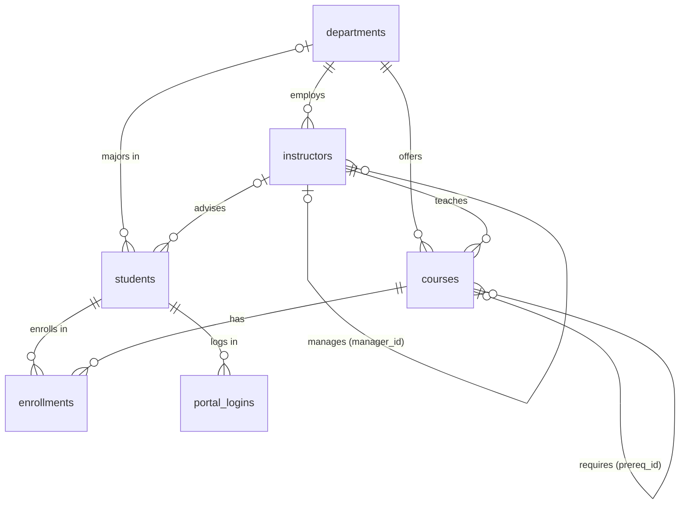

# Campus — 31 MySQL interview questions by pattern, one university dataset

A small university: departments, instructors, students, courses, enrollments and portal logins, Aug 2024 – Aug 2025. Every question is grouped by the pattern it drills, and every answer is MySQL 8.0.

**Setup:** run `setup.sql` in MySQL Workbench — it drops and recreates the six tables.  
**Check yourself:** every question has its expected output in a fold, computed by running the reference queries.  
**Solutions:** `solutions.sql`, keyed `-- @Q1` … `-- @Q31`, MySQL 8.0. Two approaches where interviewers ask for both, plus the common wrong answer marked `TRAP`.

---

## The data

| Table | Rows | Columns |
|---|---:|---|
| `departments` | 5 | dept_id, dept_name, building, budget |
| `instructors` | 10 | instructor_id, name, dept_id, hire_date, salary, manager_id |
| `students` | 13 | student_id, name, email, dept_id, enroll_year, gpa, advisor_id |
| `courses` | 10 | course_id, title, dept_id, credits, prereq_id, instructor_id |
| `enrollments` | 36 | enrollment_id, student_id, course_id, term, enrolled_on, score |
| `portal_logins` | 27 | student_id, login_date |

**Conventions:** a score of 60 or more is a pass. A NULL `score` means in progress or incomplete — never zero. Terms run `2024-FA` (Aug 2024), `2025-SP` (Jan 2025), `2025-FA` (Aug 2025). Break ties on the id column unless the question says to keep ties.

**Planted on purpose** (this is what interviewers test):
- Two accounts for one student: `JULIA@uni.edu` and `julia@uni.edu ` (with a trailing space).
- NULLs in `email`, `gpa`, `dept_id` (undeclared majors), `advisor_id`, `manager_id`, `prereq_id` and `score`.
- Ties in salaries, GPAs and course scores.
- A duplicated enrollment, and two enrollments by the same student on the same day.
- Term labels that sort wrongly as strings.
- Three courses nobody took, a department with no instructors or students, and a student who never logged in.
- Instructors who earn more than their manager.
- Two logins by one student on the same day inside a streak.

**Short on time? Do these 10 first:** Q1, Q3, Q7, Q9, Q14, Q17, Q18, Q22, Q27, Q31.

---

## Topic 1 — Joins

### Q1 · Students with their major and advisor `≈ LC 175`
List all 13 students with their major's department name as `major` and their advisor's name as `advisor`. A student with no major shows `Undeclared`; a student with no advisor shows NULL. Sort by `student_id`.

Hint

If you get 9 rows, one of your joins is an INNER JOIN.

Expected

| student_id | name | major | advisor |
|---|---|---|---|
| 1 | Aarav Shah | Computer Science | Alan Reed |
| 2 | Bella Cruz | Computer Science | Alan Reed |
| 3 | Chen Wei | Mathematics | Emmy Stone |
| 4 | Diya Nair | Computer Science | Grace Lin |
| 5 | Ethan Moss | Physics | Marie Duval |
| 6 | Fatima Ali | Mathematics | Carl Gauss |
| 7 | Gabe Ortiz | Undeclared | NULL |
| 8 | Hana Kim | History | Howard Zinn |
| 9 | Ivan Petrov | Physics | Lise Park |
| 10 | Julia Rossi | Computer Science | Edsger Holt |
| 11 | Kofi Mensah | History | NULL |
| 12 | Lena Novak | Undeclared | NULL |
| 13 | Julia Rossi | Computer Science | NULL |

### Q2 · Courses nobody has enrolled in `≈ LC 183`
Return `course_id` and `title` of every course with no enrollments at all. Solve it with `LEFT JOIN … IS NULL` and again with `NOT EXISTS`.

Expected

| course_id | title |
|---|---|
| CS401 | Distributed Systems |
| HI205 | History of Science |
| PH201 | Quantum Physics |

### Q3 · Department headcounts
For every department, including empty ones: the number of instructors and the number of students majoring in it. Sort by `dept_id`. Then explain what goes wrong if you join both tables and use `COUNT`.

Hint

Two one-to-many joins from the same parent multiply each other.

Expected

| dept_name | instructors | students |
|---|---|---|
| Computer Science | 4 | 5 |
| Mathematics | 2 | 2 |
| Physics | 2 | 2 |
| History | 2 | 2 |
| Philosophy | 0 | 0 |

Joining both tables and counting gives Computer Science **20** instructors and **20** students: 4 instructor rows × 5 student rows.

### Q4 · Instructors who out-earn their manager `≈ LC 181`
Instructors whose salary is higher than their manager's. Show `instructor`, `salary`, `manager`, `manager_salary`, sorted by the instructor's id.

Expected

| instructor | salary | manager | manager_salary |
|---|---|---|---|
| Edsger Holt | 152000.00 | Alan Reed | 118000.00 |
| Lise Park | 131000.00 | Marie Duval | 128000.00 |

---

## Topic 2 — NULL handling and data cleaning

### Q5 · COUNT(*) vs COUNT(column)
Per `enroll_year`: the number of students, and how many of them have an email, a GPA and an advisor. One pass over `students`, sorted by year.

Expected

| enroll_year | students | with_email | with_gpa | with_advisor |
|---|---|---|---|---|
| 2021 | 2 | 2 | 2 | 2 |
| 2022 | 4 | 3 | 4 | 3 |
| 2023 | 3 | 3 | 3 | 3 |
| 2024 | 4 | 4 | 0 | 1 |

### Q6 · Course averages and ungraded rows
Per course that has enrollments: total enrollments, graded enrollments (score not NULL), the average score of graded rows as `avg_score`, and the average if ungraded rows counted as 0 as `avg_if_zero`. Both averages to 1 dp. Sort by `course_id`. Which average is the honest one?

Expected

| course_id | enrollments | graded | avg_score | avg_if_zero |
|---|---|---|---|---|
| CS101 | 7 | 6 | 77.3 | 66.3 |
| CS201 | 5 | 5 | 82.6 | 82.6 |
| CS301 | 6 | 0 | NULL | 0.0 |
| HI101 | 3 | 3 | 79.0 | 79.0 |
| MA101 | 8 | 7 | 76.0 | 66.5 |
| MA201 | 4 | 3 | 88.0 | 66.0 |
| PH101 | 3 | 2 | 69.0 | 46.0 |

CS301 has no graded rows yet, so its `avg_score` is NULL — not 0.

### Q7 · The NOT IN trap
Courses that are not the prerequisite of any other course. Try `NOT IN (SELECT prereq_id FROM courses)` first and explain the result.

Expected

| course_id | title |
|---|---|
| CS401 | Distributed Systems |
| HI101 | World History |
| HI205 | History of Science |
| MA201 | Linear Algebra |
| PH201 | Quantum Physics |

`NOT IN` returns **0 rows**: `prereq_id` contains NULLs, and `x NOT IN (…, NULL)` is never true.

### Q8 · NULLs last
List students by GPA from lowest to highest, with the students who have no GPA yet at the end, then by `student_id`. MySQL has no `NULLS LAST` — find two ways.

Hint

In MySQL, NULL sorts as the smallest value: first in ascending order, last in descending order.

Expected

| student_id | name | gpa |
|---|---|---|
| 11 | Kofi Mensah | 2.50 |
| 5 | Ethan Moss | 2.80 |
| 8 | Hana Kim | 3.10 |
| 4 | Diya Nair | 3.20 |
| 9 | Ivan Petrov | 3.40 |
| 6 | Fatima Ali | 3.50 |
| 1 | Aarav Shah | 3.70 |
| 2 | Bella Cruz | 3.70 |
| 3 | Chen Wei | 3.90 |
| 7 | Gabe Ortiz | NULL |
| 10 | Julia Rossi | NULL |
| 12 | Lena Novak | NULL |
| 13 | Julia Rossi | NULL |

### Q9 · Duplicate student accounts `≈ LC 182`
Emails used by more than one student, treating case and surrounding spaces as irrelevant. Show the normalised email, the number of accounts and the student ids as a comma-separated list in ascending order (`student_ids`).

Hint

MySQL's `GROUP_CONCAT(col ORDER BY col)` builds the list.

Expected

| email | accounts | student_ids |
|---|---|---|
| julia@uni.edu | 2 | 10,13 |

A plain `GROUP BY email` finds **nothing**: one of the two emails ends in a space.

---

## Topic 3 — Aggregation and HAVING

### Q10 · Department GPA report
For departments with at least 2 students who have a GPA: the number of those students, the average GPA (2 dp) and the highest GPA. Sort by average GPA, highest first.

Expected

| dept_name | students_with_gpa | avg_gpa | max_gpa |
|---|---|---|---|
| Mathematics | 2 | 3.70 | 3.90 |
| Computer Science | 3 | 3.53 | 3.70 |
| Physics | 2 | 3.10 | 3.40 |
| History | 2 | 2.80 | 3.10 |

### Q11 · Grade distribution pivot `≈ LC 1179`
For each course with graded rows, count the grades as columns: `a` (90+), `b` (80–89.9), `c` (70–79.9), `d` (60–69.9), `f` (below 60), plus `graded`. Sort by `course_id`.

Expected

| course_id | a | b | c | d | f | graded |
|---|---|---|---|---|---|---|
| CS101 | 2 | 1 | 2 | 0 | 1 | 6 |
| CS201 | 1 | 2 | 1 | 1 | 0 | 5 |
| HI101 | 1 | 1 | 0 | 1 | 0 | 3 |
| MA101 | 1 | 2 | 2 | 1 | 1 | 7 |
| MA201 | 1 | 1 | 1 | 0 | 0 | 3 |
| PH101 | 0 | 1 | 0 | 0 | 1 | 2 |

### Q12 · Pass rate per course
For each course with graded rows: graded count, passed count (score 60 or more) and pass rate % (1 dp). Sort by pass rate, lowest first, then `course_id`.

Expected

| course_id | graded | passed | pass_rate_pct |
|---|---|---|---|
| PH101 | 2 | 1 | 50.0 |
| CS101 | 6 | 5 | 83.3 |
| MA101 | 7 | 6 | 85.7 |
| CS201 | 5 | 5 | 100.0 |
| HI101 | 3 | 3 | 100.0 |
| MA201 | 3 | 3 | 100.0 |

### Q13 · Duplicate enrollments
A student should be enrolled in a course at most once per term. Find every (`student_id`, `course_id`, `term`) that appears more than once, with the number of copies and the `enrollment_ids` (comma-separated, ascending).

Expected

| student_id | course_id | term | copies | enrollment_ids |
|---|---|---|---|---|
| 2 | CS301 | 2025-FA | 2 | 29,36 |

---

## Topic 4 — Subqueries and CTEs

### Q14 · Second highest salary `≈ LC 176`
Return the second-highest **distinct** instructor salary as `second_highest_salary`. If there isn't one, return a single row with NULL.

Expected

| second_highest_salary |
|---|
| 145000.00 |

### Q15 · Above the course average
Graded enrollments whose score beats the average graded score of their course. Show `course_id`, `student_id`, `score` and `course_avg` (1 dp), sorted by course then student. Solve it with a correlated subquery and with a window function.

Expected

| course_id | student_id | score | course_avg |
|---|---|---|---|
| CS101 | 1 | 92.0 | 77.3 |
| CS101 | 2 | 88.0 | 77.3 |
| CS101 | 3 | 90.0 | 77.3 |
| CS201 | 1 | 95.0 | 82.6 |
| CS201 | 2 | 88.0 | 82.6 |
| CS201 | 3 | 88.0 | 82.6 |
| HI101 | 7 | 90.0 | 79.0 |
| HI101 | 8 | 85.0 | 79.0 |
| MA101 | 1 | 84.0 | 76.0 |
| MA101 | 3 | 95.0 | 76.0 |
| MA101 | 6 | 81.0 | 76.0 |
| MA101 | 9 | 77.0 | 76.0 |
| MA201 | 3 | 97.0 | 88.0 |
| PH101 | 9 | 83.0 | 69.0 |

### Q16 · Highest-paid department
The department with the largest total instructor salary, as `dept_name` and `total_salary`. Write it so that tied departments would all be returned — no `LIMIT 1`.

Expected

| dept_name | total_salary |
|---|---|
| Computer Science | 533000.00 |

### Q17 · Passed every Mathematics course `≈ LC 1045`
Students who have a passing score (60 or more) in **every** Mathematics course (`dept_id` 20). In-progress enrollments don't count. Two ways: `HAVING COUNT(DISTINCT …)` and double `NOT EXISTS`.

Hint

Ivan is enrolled in both Mathematics courses, but one has no score yet.

Expected

| student_id | name |
|---|---|
| 1 | Aarav Shah |
| 3 | Chen Wei |
| 6 | Fatima Ali |

---

## Topic 5 — Window functions: ranking

### Q18 · Top 2 scores per course `≈ LC 185`
For each course, the students holding the top 2 distinct scores (graded rows only), using `DENSE_RANK`. Show `course_id`, `rnk`, `student_id`, `score`.

Expected

| course_id | rnk | student_id | score |
|---|---|---|---|
| CS101 | 1 | 1 | 92.0 |
| CS101 | 2 | 3 | 90.0 |
| CS201 | 1 | 1 | 95.0 |
| CS201 | 2 | 2 | 88.0 |
| CS201 | 2 | 3 | 88.0 |
| HI101 | 1 | 7 | 90.0 |
| HI101 | 2 | 8 | 85.0 |
| MA101 | 1 | 3 | 95.0 |
| MA101 | 2 | 1 | 84.0 |
| MA201 | 1 | 3 | 97.0 |
| MA201 | 2 | 1 | 88.0 |
| PH101 | 1 | 9 | 83.0 |
| PH101 | 2 | 5 | 55.0 |

### Q19 · ROW_NUMBER vs RANK vs DENSE_RANK `≈ LC 178`
Rank instructors by salary (highest first) within their department three ways: `row_num` (ties broken by `instructor_id`), `rnk` and `dense_rnk`. Be ready to explain the difference.

Expected

| dept_id | instructor_id | name | salary | row_num | rnk | dense_rnk |
|---|---|---|---|---|---|---|
| 10 | 104 | Edsger Holt | 152000.00 | 1 | 1 | 1 |
| 10 | 101 | Ada Byron | 145000.00 | 2 | 2 | 2 |
| 10 | 102 | Alan Reed | 118000.00 | 3 | 3 | 3 |
| 10 | 103 | Grace Lin | 118000.00 | 4 | 3 | 3 |
| 20 | 105 | Emmy Stone | 132000.00 | 1 | 1 | 1 |
| 20 | 106 | Carl Gauss | 99000.00 | 2 | 2 | 2 |
| 30 | 108 | Lise Park | 131000.00 | 1 | 1 | 1 |
| 30 | 107 | Marie Duval | 128000.00 | 2 | 2 | 2 |
| 40 | 109 | Howard Zinn | 87000.00 | 1 | 1 | 1 |
| 40 | 110 | Mary Beard | 87000.00 | 2 | 1 | 1 |

### Q20 · Nth highest salary `≈ LC 177`
The 3rd highest distinct salary as `nth_highest_salary`, written so changing N is a one-number edit. Solve it with `DENSE_RANK` and with `LIMIT … OFFSET`.

Expected

| nth_highest_salary |
|---|
| 132000.00 |

### Q21 · Each student's best course
Exactly one row per student with graded enrollments: their highest-scoring course. Break ties by the earlier `enrolled_on`, then `course_id`. Show `student_id`, `course_id`, `score`.

Expected

| student_id | course_id | score |
|---|---|---|
| 1 | CS201 | 95.0 |
| 2 | CS101 | 88.0 |
| 3 | MA201 | 97.0 |
| 4 | CS101 | 75.0 |
| 5 | MA101 | 71.0 |
| 6 | MA101 | 81.0 |
| 7 | HI101 | 90.0 |
| 8 | HI101 | 85.0 |
| 9 | PH101 | 83.0 |
| 10 | CS201 | 74.0 |
| 11 | HI101 | 62.0 |

---

## Topic 6 — Window functions: running totals and offsets

### Q22 · Running credits per student `≈ LC 1204`
For students 1 and 3, every enrollment with the course's credits and a running total of credits per student, in `enrolled_on` order (ties broken by `course_id`). Then: what changes if you `ORDER BY enrolled_on` only?

Expected

| student_id | course_id | enrolled_on | credits | running_credits |
|---|---|---|---|---|
| 1 | CS101 | 2024-08-20 | 4 | 4 |
| 1 | MA101 | 2024-08-20 | 4 | 8 |
| 1 | CS201 | 2025-01-13 | 4 | 12 |
| 1 | MA201 | 2025-01-13 | 3 | 15 |
| 1 | CS301 | 2025-08-25 | 3 | 18 |
| 3 | MA101 | 2024-08-19 | 4 | 4 |
| 3 | CS101 | 2024-08-22 | 4 | 8 |
| 3 | MA201 | 2025-01-13 | 3 | 11 |
| 3 | CS201 | 2025-01-14 | 4 | 15 |
| 3 | CS301 | 2025-08-26 | 3 | 18 |

With `ORDER BY enrolled_on` alone, the default `RANGE` frame gives both of student 1's 2024-08-20 rows **8** — the whole day at once.

### Q23 · Score change between terms `≈ LC 197`
Per student and term: the average graded score (1 dp), the previous graded term's average and the change. Only rows that have a previous term. Order terms by date, not by the term string. Sort by `student_id`.

Hint

Aggregate to one row per student and term first, then use `LAG`.

Expected

| student_id | term | avg_score | prev_avg | change_pts |
|---|---|---|---|---|
| 1 | 2025-SP | 91.5 | 88.0 | 3.5 |
| 2 | 2025-SP | 88.0 | 88.0 | 0.0 |
| 3 | 2025-SP | 92.5 | 92.5 | 0.0 |
| 4 | 2025-SP | 68.0 | 75.0 | -7.0 |
| 5 | 2025-SP | 63.0 | 58.0 | 5.0 |
| 6 | 2025-SP | 79.0 | 81.0 | -2.0 |
| 8 | 2025-SP | 66.0 | 85.0 | -19.0 |
| 9 | 2025-SP | 83.0 | 77.0 | 6.0 |
| 10 | 2025-SP | 74.0 | 70.0 | 4.0 |
| 11 | 2025-SP | 49.0 | 62.0 | -13.0 |

### Q24 · Salary share of department
Every instructor with their department's average salary (2 dp) and their salary as a % of the department's total payroll (1 dp). Sort by `dept_id`, then salary (highest first), then `instructor_id`.

Expected

| dept_id | name | salary | dept_avg | pct_of_dept |
|---|---|---|---|---|
| 10 | Edsger Holt | 152000.00 | 133250.00 | 28.5 |
| 10 | Ada Byron | 145000.00 | 133250.00 | 27.2 |
| 10 | Alan Reed | 118000.00 | 133250.00 | 22.1 |
| 10 | Grace Lin | 118000.00 | 133250.00 | 22.1 |
| 20 | Emmy Stone | 132000.00 | 115500.00 | 57.1 |
| 20 | Carl Gauss | 99000.00 | 115500.00 | 42.9 |
| 30 | Lise Park | 131000.00 | 129500.00 | 50.6 |
| 30 | Marie Duval | 128000.00 | 129500.00 | 49.4 |
| 40 | Howard Zinn | 87000.00 | 87000.00 | 50.0 |
| 40 | Mary Beard | 87000.00 | 87000.00 | 50.0 |

### Q25 · First and latest course per student
One row per student with enrollments: their first course and their latest course by `enrolled_on` (ties broken by `course_id`), using `FIRST_VALUE` and `LAST_VALUE`.

Hint

If `LAST_VALUE` keeps returning the current row's course, look at the window frame.

Expected

| student_id | first_course | latest_course |
|---|---|---|
| 1 | CS101 | CS301 |
| 2 | CS101 | CS301 |
| 3 | MA101 | CS301 |
| 4 | CS101 | CS301 |
| 5 | MA101 | PH101 |
| 6 | MA101 | PH101 |
| 7 | HI101 | CS101 |
| 8 | HI101 | MA101 |
| 9 | MA101 | MA201 |
| 10 | CS101 | CS301 |
| 11 | HI101 | MA101 |

---

## Topic 7 — Dates and gaps-and-islands

### Q26 · Enrollments per term, in order
Enrollments per term in chronological order, with the previous term's count and the change. Check what `ORDER BY term` does first.

Expected

| term | enrollments | prev_enrollments | change_count |
|---|---|---|---|
| 2024-FA | 12 | NULL | NULL |
| 2025-SP | 15 | 12 | 3 |
| 2025-FA | 9 | 15 | -6 |

`ORDER BY term` sorts the strings: 2024-FA, **2025-FA**, 2025-SP — spring lands after fall.

### Q27 · Login streaks `≈ LC 180 / 1285`
Students who logged in to the portal on 3 or more consecutive days. Return `student_id`, `streak_start`, `streak_end` and `days`.

Hint

`date − ROW_NUMBER()` days is constant inside a run. Then check what happens on a day with two logins.

Expected

| student_id | streak_start | streak_end | days |
|---|---|---|---|
| 1 | 2025-03-01 | 2025-03-03 | 3 |
| 3 | 2025-03-02 | 2025-03-05 | 4 |
| 6 | 2025-03-04 | 2025-03-06 | 3 |
| 10 | 2025-03-20 | 2025-03-23 | 4 |

### Q28 · Next-day retention `≈ LC 550`
Of the students who ever logged in, what fraction logged in again on the day right after their first login? Return `students`, `retained` and `fraction` (2 dp).

Expected

| students | retained | fraction |
|---|---|---|
| 9 | 6 | 0.67 |

### Q29 · Inactive students
As of 2025-03-31: every student with their last login date and the number of days since it (`days_inactive`). Students who never logged in show NULL for both and come first; then most inactive first, then `student_id`.

Hint

`DATEDIFF(later, earlier)` returns whole days in MySQL.

Expected

| student_id | name | last_login | days_inactive |
|---|---|---|---|
| 8 | Hana Kim | NULL | NULL |
| 11 | Kofi Mensah | NULL | NULL |
| 12 | Lena Novak | NULL | NULL |
| 13 | Julia Rossi | NULL | NULL |
| 9 | Ivan Petrov | 2025-03-03 | 28 |
| 2 | Bella Cruz | 2025-03-04 | 27 |
| 1 | Aarav Shah | 2025-03-05 | 26 |
| 3 | Chen Wei | 2025-03-05 | 26 |
| 6 | Fatima Ali | 2025-03-06 | 25 |
| 5 | Ethan Moss | 2025-03-08 | 23 |
| 4 | Diya Nair | 2025-03-10 | 21 |
| 7 | Gabe Ortiz | 2025-03-16 | 15 |
| 10 | Julia Rossi | 2025-03-25 | 6 |

---

## Topic 8 — Recursive CTEs

### Q30 · Prerequisite chain
`WITH RECURSIVE`: everything you must take before CS401, as `depth` (CS401 itself is 0), `course_id`, `title` and `path`, like `CS401 > CS301`.

Expected

| depth | course_id | title | path |
|---|---|---|---|
| 0 | CS401 | Distributed Systems | CS401 |
| 1 | CS301 | Databases | CS401 > CS301 |
| 2 | CS201 | Data Structures | CS401 > CS301 > CS201 |
| 3 | CS101 | Intro to Programming | CS401 > CS301 > CS201 > CS101 |

### Q31 · Instructor org chart `≈ LC 1270`
Every instructor with their `level` (department heads are 1) and their reporting `chain` from the head down, like `Ada Byron > Alan Reed`. Sort by `instructor_id`.

Expected

| instructor_id | name | level | chain |
|---|---|---|---|
| 101 | Ada Byron | 1 | Ada Byron |
| 102 | Alan Reed | 2 | Ada Byron > Alan Reed |
| 103 | Grace Lin | 2 | Ada Byron > Grace Lin |
| 104 | Edsger Holt | 3 | Ada Byron > Alan Reed > Edsger Holt |
| 105 | Emmy Stone | 1 | Emmy Stone |
| 106 | Carl Gauss | 2 | Emmy Stone > Carl Gauss |
| 107 | Marie Duval | 1 | Marie Duval |
| 108 | Lise Park | 2 | Marie Duval > Lise Park |
| 109 | Howard Zinn | 1 | Howard Zinn |
| 110 | Mary Beard | 2 | Howard Zinn > Mary Beard |

