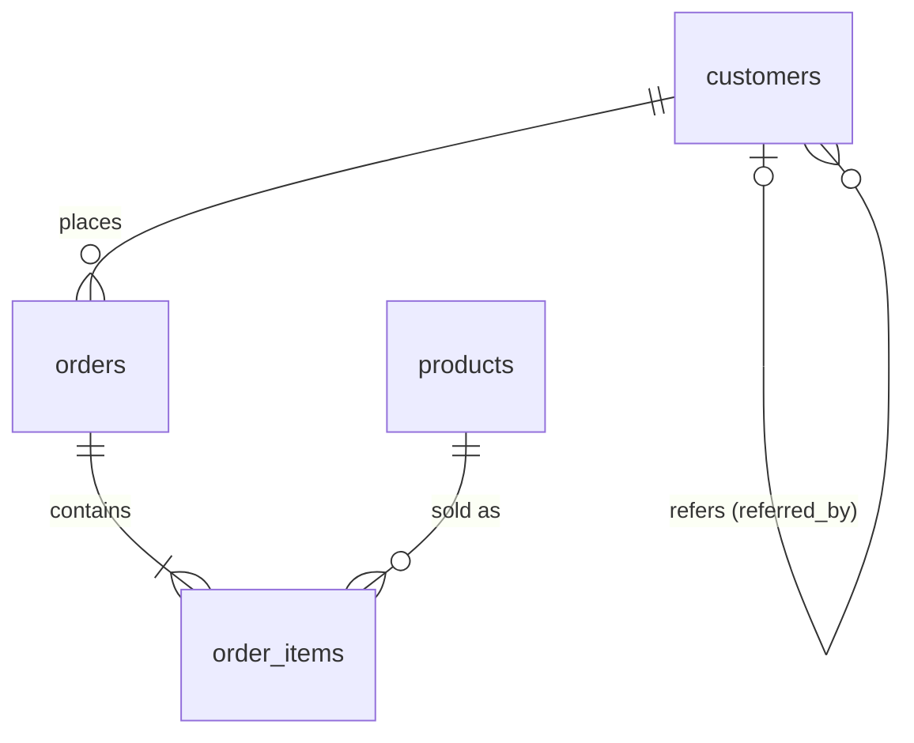

# ShopLite — 30 classic SQL interview questions, one small dataset

One tiny online store. 4 tables, ~110 rows, Jan–Jun 2025. Small enough to eyeball every answer, built so every classic pattern (and its usual trap) actually shows up.

**Setup:** run `setup.sql` — plain standard SQL, tested on Postgres, DuckDB and SQLite; pastes into any online fiddle.
**Check yourself:** every question has its expected output in a fold. All answers were run and cross-checked on PostgreSQL 16 and DuckDB.
**Solutions:** `solutions.sql`, keyed `-- @Q1` … `-- @Q30`. Two approaches where interviewers ask for both, plus the common wrong answer marked `TRAP`.

---

## The data

| Table | Rows | Columns |
|---|---:|---|
| `customers` | 13 | customer_id, name, email, city, signup_date, referred_by |
| `products` | 8 | product_id, product_name, category, price |
| `orders` | 38 | order_id, customer_id, order_date, status (`completed` / `cancelled`), amount |
| `order_items` | 54 | order_id, product_id, quantity, unit_price |

**Conventions:** revenue / spend = **completed orders only** unless the question says otherwise. `amount` always equals the order's `SUM(quantity * unit_price)`. Break ties on the id column unless the question says to keep ties.

**Planted on purpose** (this is what interviewers test):
- Two duplicate accounts: one exact email, one differing only in case (`ALICE@mail.com`).
- NULLs in `city` and `referred_by`.
- Ties in order amounts and in customer spend.
- A customer who ordered twice on the same day.
- A customer whose only order was cancelled, and three customers with no orders at all.
- A product that never sold.

**Short on time? Do these 10 first:** Q1, Q4, Q6, Q8, Q9, Q14, Q15, Q19, Q22, Q27.

---

## Tier A — asked in almost every screen

### Q1 · Second highest order amount `≈ LC 176`
Return the second-highest **distinct** completed order amount as `second_highest`. If there isn't one, the query must return a single row with NULL, not an empty result.

Hint

Two ways: `MAX` of everything below the `MAX`, or `DENSE_RANK` wrapped in a scalar subquery.

Expected

| second_highest |
|---|
| 160.00 |

### Q2 · Nth highest order amount `≈ LC 177`
Same as Q1 for N = 3. Write it so changing N is a one-number edit. Solve it with `DENSE_RANK` and with `LIMIT … OFFSET`.

Expected

| nth_highest |
|---|
| 145.00 |

### Q3 · Duplicate emails `≈ LC 182`
List every email used by more than one account and how many accounts use it. Emails differing only in case or surrounding spaces count as the same.

Expected

| email | accounts |
|---|---|
| alice@mail.com | 2 |
| ben@mail.com | 2 |

### Q4 · Delete duplicate accounts `≈ LC 196`
Delete duplicate accounts (same normalized email), keeping the lowest `customer_id`. Preview the rows you'll delete first. (Safe here because the duplicates have no orders. In real life you'd re-point their orders first.)

Expected

Rows to delete:

| customer_id | email |
|---|---|
| 11 | ALICE@mail.com |
| 13 | ben@mail.com |

After the delete: **11** customers left.

### Q5 · Anti-joins and the NOT IN trap `≈ LC 183`
(a) Customers who have never placed an order (any status).
(b) Customers who have never referred anyone. Try `NOT IN (SELECT referred_by FROM customers)` first and explain the result.

Expected (a)

| customer_id | name |
|---|---|
| 11 | Alice Kim |
| 12 | Kai Brooks |
| 13 | Ben Ortiz |

Expected (b)

| customer_id | name |
|---|---|
| 6 | Farah Khan |
| 9 | Ivan Petrov |
| 10 | Jade Wu |
| 11 | Alice Kim |
| 12 | Kai Brooks |
| 13 | Ben Ortiz |

`NOT IN` returns **0 rows**: `referred_by` contains NULLs, and `x NOT IN (…, NULL)` is never true.

### Q6 · Every customer with their spend `≈ LC 175`
All 13 customers with their number of completed orders and total completed spend (0 if none). Sort by spend desc, then id.

Hint

If you get 9 rows, look at where your `status` filter lives.

Expected

| customer_id | name | orders | total_spend |
|---|---|---|---|
| 8 | Hana Sato | 3 | 405.00 |
| 4 | Dev Patel | 3 | 309.00 |
| 1 | Alice Kim | 5 | 301.00 |
| 7 | Gus Nolan | 3 | 301.00 |
| 3 | Chloe Park | 6 | 280.00 |
| 2 | Ben Ortiz | 4 | 270.00 |
| 6 | Farah Khan | 3 | 259.00 |
| 9 | Ivan Petrov | 3 | 216.00 |
| 5 | Emma Lee | 4 | 176.00 |
| 10 | Jade Wu | 0 | 0 |
| 11 | Alice Kim | 0 | 0 |
| 12 | Kai Brooks | 0 | 0 |
| 13 | Ben Ortiz | 0 | 0 |

### Q7 · Frequent buyers `≈ LC 596`
Customers with 4 or more completed orders, with their count.

Expected

| customer_id | orders |
|---|---|
| 3 | 6 |
| 1 | 5 |
| 2 | 4 |
| 5 | 4 |

### Q8 · Top spender in each city `≈ LC 184`
The highest-spending customer in each city. If two customers tie, return both. Solve it with a window function and without one.

Expected

| city | customer_id | name | total_spend |
|---|---|---|---|
| Austin | 1 | Alice Kim | 301.00 |
| Austin | 7 | Gus Nolan | 301.00 |
| Boston | 2 | Ben Ortiz | 270.00 |
| Chicago | 4 | Dev Patel | 309.00 |
| Denver | 8 | Hana Sato | 405.00 |

### Q9 · Top 2 products per category `≈ LC 185`
Top 2 products by revenue in each category, using `DENSE_RANK`.

Expected

| category | rnk | product_name | revenue |
|---|---|---|---|
| Apparel | 1 | Running Shoes | 810.00 |
| Apparel | 2 | Hoodie | 360.00 |
| Electronics | 1 | Mechanical Keyboard | 560.00 |
| Electronics | 2 | USB-C Hub | 240.00 |
| Grocery | 1 | Coffee Beans | 252.00 |

### Q10 · ROW_NUMBER vs RANK vs DENSE_RANK `≈ LC 178`
For completed orders, show all three rankings by amount (desc). Return only rows with dense rank ≤ 7. Be ready to explain the difference out loud.

Expected

| order_id | amount | row_num | rnk | dense_rnk |
|---|---|---|---|---|
| 1017 | 180.00 | 1 | 1 | 1 |
| 1032 | 160.00 | 2 | 2 | 2 |
| 1016 | 145.00 | 3 | 3 | 3 |
| 1021 | 135.00 | 4 | 4 | 4 |
| 1034 | 135.00 | 5 | 4 | 4 |
| 1006 | 120.00 | 6 | 6 | 5 |
| 1030 | 114.00 | 7 | 7 | 6 |
| 1001 | 105.00 | 8 | 8 | 7 |
| 1023 | 105.00 | 9 | 8 | 7 |

### Q11 · Monthly summary `≈ LC 1193`
Per month: all orders, completed orders, completed revenue. One pass over `orders`.

Expected

| month | orders | completed_orders | revenue |
|---|---|---|---|
| 2025-01-01 | 5 | 4 | 321.00 |
| 2025-02-01 | 5 | 5 | 374.00 |
| 2025-03-01 | 8 | 7 | 505.00 |
| 2025-04-01 | 7 | 6 | 414.00 |
| 2025-05-01 | 6 | 6 | 403.00 |
| 2025-06-01 | 7 | 6 | 500.00 |

### Q12 · Revenue share by category
Revenue per category and its % of total revenue (1 dp). Bonus: do it in a single `SELECT` with no CTE.

Expected

| category | revenue | pct_of_total |
|---|---|---|
| Apparel | 1290.00 | 51.3 |
| Electronics | 975.00 | 38.7 |
| Grocery | 252.00 | 10.0 |

---

## Tier B — window functions (every data engineering loop)

### Q13 · Running total `≈ LC 1204`
Completed orders in March 2025, one row per order, with a running total of `amount` by date (ties broken by `order_id`). Then: what changes if you `ORDER BY order_date` only?

Expected

| order_id | order_date | amount | running_total |
|---|---|---|---|
| 1011 | 2025-03-08 | 80.00 | 80.00 |
| 1012 | 2025-03-10 | 25.00 | 105.00 |
| 1013 | 2025-03-11 | 18.00 | 123.00 |
| 1014 | 2025-03-11 | 12.00 | 135.00 |
| 1015 | 2025-03-12 | 45.00 | 180.00 |
| 1016 | 2025-03-12 | 145.00 | 325.00 |
| 1017 | 2025-03-18 | 180.00 | 505.00 |

With `ORDER BY order_date` alone, the default `RANGE` frame gives both Mar 11 orders 135.00 and both Mar 12 orders 325.00.

### Q14 · Month-over-month growth
Monthly revenue, previous month's revenue, and MoM growth % (1 dp).

Expected

| month | revenue | prev_revenue | mom_pct |
|---|---|---|---|
| 2025-01-01 | 321.00 | NULL | NULL |
| 2025-02-01 | 374.00 | 321.00 | 16.5 |
| 2025-03-01 | 505.00 | 374.00 | 35.0 |
| 2025-04-01 | 414.00 | 505.00 | -18.0 |
| 2025-05-01 | 403.00 | 414.00 | -2.7 |
| 2025-06-01 | 500.00 | 403.00 | 24.1 |

### Q15 · Latest order per customer
Each customer's most recent completed order: exactly one row per customer (order_id, order_date, amount). The "latest record per key" dedup — the single most common DE question.

Expected

| customer_id | order_id | order_date | amount |
|---|---|---|---|
| 1 | 1033 | 2025-06-03 | 18.00 |
| 2 | 1031 | 2025-05-30 | 57.00 |
| 3 | 1027 | 2025-05-05 | 90.00 |
| 4 | 1034 | 2025-06-04 | 135.00 |
| 5 | 1035 | 2025-06-10 | 52.00 |
| 6 | 1030 | 2025-05-21 | 114.00 |
| 7 | 1037 | 2025-06-20 | 90.00 |
| 8 | 1032 | 2025-06-02 | 160.00 |
| 9 | 1038 | 2025-06-28 | 45.00 |

### Q16 · Bigger than last time `≈ LC 197`
Completed orders whose amount is larger than the same customer's previous completed order. Show the previous amount too.

Expected

| customer_id | order_id | order_date | prev_amount | amount |
|---|---|---|---|---|
| 1 | 1008 | 2025-02-14 | 36.00 | 102.00 |
| 2 | 1023 | 2025-04-15 | 18.00 | 105.00 |
| 3 | 1015 | 2025-03-12 | 12.00 | 45.00 |
| 3 | 1027 | 2025-05-05 | 45.00 | 90.00 |
| 4 | 1034 | 2025-06-04 | 54.00 | 135.00 |
| 5 | 1035 | 2025-06-10 | 25.00 | 52.00 |
| 6 | 1011 | 2025-03-08 | 65.00 | 80.00 |
| 6 | 1030 | 2025-05-21 | 80.00 | 114.00 |
| 7 | 1037 | 2025-06-20 | 66.00 | 90.00 |
| 8 | 1032 | 2025-06-02 | 65.00 | 160.00 |
| 9 | 1038 | 2025-06-28 | 36.00 | 45.00 |

### Q17 · Days between orders
For customers with 2+ completed orders: number of gaps and average days between consecutive orders. Bonus: there's a shortcut that needs no window function.

Expected

| customer_id | gaps | avg_days_between |
|---|---|---|
| 3 | 5 | 22.6 |
| 1 | 4 | 37.8 |
| 8 | 2 | 38.0 |
| 9 | 2 | 42.0 |
| 5 | 3 | 42.3 |
| 6 | 2 | 47.5 |
| 2 | 3 | 48.0 |
| 7 | 2 | 50.0 |
| 4 | 2 | 61.0 |

### Q18 · 3-month moving average `≈ LC 1321`
Monthly revenue with a trailing 3-month average. Only return months that have a full 3-month window.

Expected

| month | revenue | moving_avg_3m |
|---|---|---|
| 2025-03-01 | 505.00 | 400.00 |
| 2025-04-01 | 414.00 | 431.00 |
| 2025-05-01 | 403.00 | 440.67 |
| 2025-06-01 | 500.00 | 439.00 |

### Q19 · Consecutive days `≈ LC 180 / 601`
Customers who placed completed orders on 3 or more consecutive days. Return the streak start, end and length.

Hint

`date − ROW_NUMBER()` is constant inside a run. Then check what happens on a day with two orders.

Expected

| customer_id | streak_start | streak_end | days |
|---|---|---|---|
| 3 | 2025-03-10 | 2025-03-12 | 3 |

### Q20 · Median `≈ LC 569`
Median completed order amount. Do it with `PERCENTILE_CONT`, and again without it (MySQL has none).

Expected

| median_amount |
|---|
| 65.50 |

34 orders, so it's the average of the 17th and 18th values.

---

## Tier C — senior-level and business logic

### Q21 · Outspent the referrer `≈ LC 181`
Customers whose total spend is higher than the customer who referred them. Show both spends.

Expected

| customer_id | name | total_spend | referrer_id | referrer_name | referrer_spend |
|---|---|---|---|---|---|
| 7 | Gus Nolan | 301.00 | 3 | Chloe Park | 280.00 |

### Q22 · Bought every Electronics product `≈ LC 1045`
Customers who have bought every product in the Electronics category (across any of their completed orders). Two ways: `HAVING COUNT(DISTINCT …)` and double `NOT EXISTS`.

Expected

| customer_id | name |
|---|---|
| 1 | Alice Kim |
| 6 | Farah Khan |
| 7 | Gus Nolan |
| 8 | Hana Sato |

### Q23 · Bought together
Product pairs that appear in the same completed order at least twice. Each pair once.

Expected

| product_a | product_b | orders_together |
|---|---|---|
| Wireless Mouse | Mechanical Keyboard | 3 |
| Wireless Mouse | USB-C Hub | 3 |
| Mechanical Keyboard | USB-C Hub | 2 |
| Running Shoes | Hoodie | 2 |
| Running Shoes | Socks 3-Pack | 2 |
| Hoodie | Socks 3-Pack | 2 |
| Socks 3-Pack | Coffee Beans | 2 |

### Q24 · Cancellation rate `≈ LC 1934`
For customers who cancelled at least once: total orders, cancelled orders, cancellation rate % (1 dp).

Expected

| customer_id | orders | cancelled | cancel_rate_pct |
|---|---|---|---|
| 10 | 1 | 1 | 100.0 |
| 4 | 4 | 1 | 25.0 |
| 1 | 6 | 1 | 16.7 |
| 3 | 7 | 1 | 14.3 |

### Q25 · Pivot `≈ LC 1179`
Revenue with categories as rows and Jan–Jun as columns, plus a total column.

Expected

| category | jan | feb | mar | apr | may | jun | total |
|---|---|---|---|---|---|---|---|
| Apparel | 180.00 | 171.00 | 237.00 | 147.00 | 273.00 | 282.00 | 1290.00 |
| Electronics | 105.00 | 185.00 | 250.00 | 195.00 | 40.00 | 200.00 | 975.00 |
| Grocery | 36.00 | 18.00 | 18.00 | 72.00 | 90.00 | 18.00 | 252.00 |

### Q26 · New vs returning
Per month: active customers, new customers (first completed order that month), returning customers.

Expected

| month | active_customers | new_customers | returning_customers |
|---|---|---|---|
| 2025-01-01 | 3 | 3 | 0 |
| 2025-02-01 | 5 | 3 | 2 |
| 2025-03-01 | 4 | 2 | 2 |
| 2025-04-01 | 5 | 1 | 4 |
| 2025-05-01 | 6 | 0 | 6 |
| 2025-06-01 | 6 | 0 | 6 |

### Q27 · 30-day repeat rate `≈ LC 550`
Of all customers with a completed order, what % placed their second completed order within 30 days of their first?

Expected

| buyers | repeated_within_30d | repeat_rate_pct |
|---|---|---|
| 9 | 2 | 22.2 |

### Q28 · Days with no orders
For each month Jan–Jun 2025: days in the month, days with at least one completed order, days with none.

Hint

You can't `GROUP BY` rows that don't exist. Generate the calendar first (`generate_series`, or a recursive CTE in MySQL).

Expected

| month | days_in_month | days_with_orders | zero_order_days |
|---|---|---|---|
| 2025-01-01 | 31 | 4 | 27 |
| 2025-02-01 | 28 | 5 | 23 |
| 2025-03-01 | 31 | 5 | 26 |
| 2025-04-01 | 30 | 6 | 24 |
| 2025-05-01 | 31 | 6 | 25 |
| 2025-06-01 | 30 | 6 | 24 |

### Q29 · Above the city average `≈ LC 615`
Customers whose total spend beats the average spend of buyers in their own city. Show the city average.

Expected

| city | customer_id | name | total_spend | city_avg |
|---|---|---|---|---|
| Austin | 1 | Alice Kim | 301.00 | 294.00 |
| Austin | 7 | Gus Nolan | 301.00 | 294.00 |
| Boston | 2 | Ben Ortiz | 270.00 | 223.00 |
| Chicago | 4 | Dev Patel | 309.00 | 284.00 |
| Denver | 8 | Hana Sato | 405.00 | 310.50 |

### Q30 · Referral chains `≈ LC 1270`
`WITH RECURSIVE`: for every referred customer, their depth and the full chain from the original referrer, like `Alice Kim > Chloe Park > Gus Nolan`.

Expected

| customer_id | name | depth | path |
|---|---|---|---|
| 2 | Ben Ortiz | 2 | Alice Kim > Ben Ortiz |
| 3 | Chloe Park | 2 | Alice Kim > Chloe Park |
| 5 | Emma Lee | 3 | Alice Kim > Ben Ortiz > Emma Lee |
| 6 | Farah Khan | 2 | Dev Patel > Farah Khan |
| 7 | Gus Nolan | 3 | Alice Kim > Chloe Park > Gus Nolan |
| 9 | Ivan Petrov | 2 | Hana Sato > Ivan Petrov |
| 10 | Jade Wu | 4 | Alice Kim > Ben Ortiz > Emma Lee > Jade Wu |
| 12 | Kai Brooks | 4 | Alice Kim > Chloe Park > Gus Nolan > Kai Brooks |

